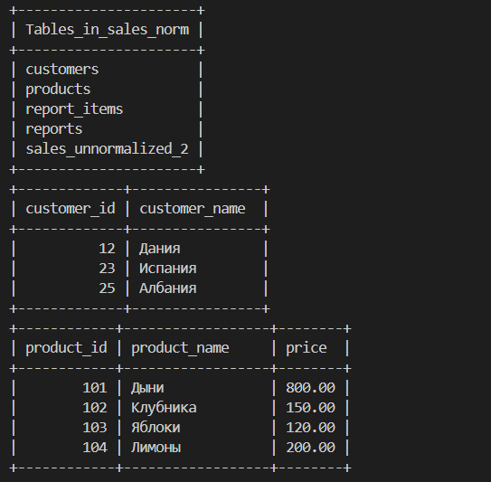
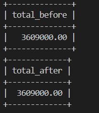
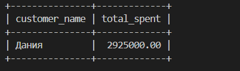

# Лабораторная работа №5: Нормализация данных в БД

## 🎯 Цель работы
Привести «плохую» ненормализованную таблицу к Третьей нормальной форме (3NF), разбив её на 4 связанные таблицы. Проверить, что данные не потерялись.

## ⚙️ Выполненные шаги
1. Создана база данных `sales_norm` и исходная таблица `sales_unnormalized_2`.
2. Созданы 4 нормализованные таблицы: `customers`, `products`, `reports`, `report_items`.
3. Данные перенесены с помощью `INSERT ... SELECT`.
4. Проверено, что общая сумма (`SUM(price * quantity)`) до и после совпадает.
5. Создан дамп базы данных `dump_clean.sql`.
6. Выгружен и отфильтрован лог `my_actions.log`.

## 📸 Скриншоты результатов

## 📁 Описание файлов
* **`my.cnf`** — конфигурация MySQL.
* **`dump_clean.sql`** — дамп базы данных `sales_norm`.
* **`my_actions.log`** — лог SQL-запросов.
* **`README.md`** — описание работы.
